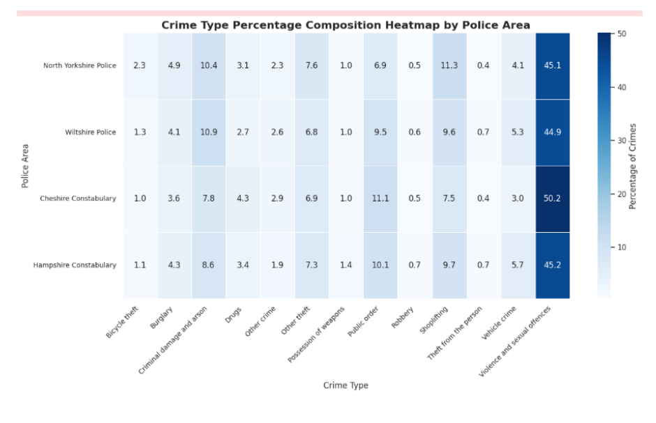
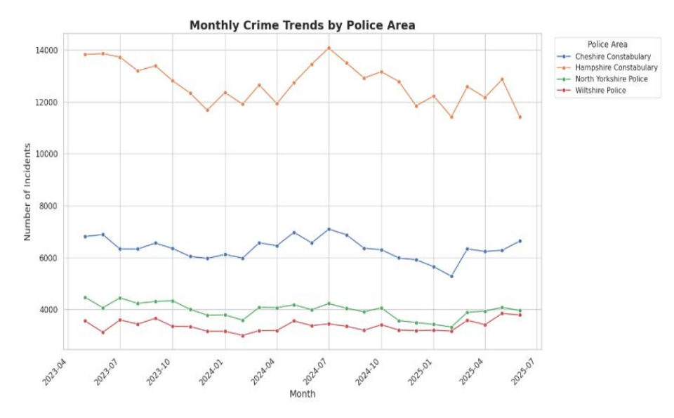

# Big Data Analytics with Spark

Two-part project using Apache Spark: large-scale crime data analysis with Spark SQL, and a machine learning classification pipeline with Spark MLlib.

## Part 1: Crime Data Analysis with Spark SQL

### Data
- UK Police open data (data.police.uk), May 2023 to June 2025 (26 months)
- 800,899 recorded crimes across four police forces: Hampshire, Cheshire, North Yorkshire, and Wiltshire
- 686,639 records after cleaning

### Approach
1. Loaded multiple monthly CSV files into Spark and registered them as SQL views
2. Cleaned the data by selecting key columns and removing records without a Crime ID
3. Used Spark SQL aggregations to rank crime types overall and by police area
4. Applied window functions (ROW_NUMBER partitioned by area) to find the top 5 crimes per force
5. Calculated each crime type's percentage share within each force
6. Built monthly time series to compare trends across forces

### Key findings
- Violence and sexual offences was the largest category in every force, from 44.9% (Wiltshire) to 50.2% (Cheshire)
- Hampshire recorded the most crime (330,796), consistent with its larger population
- Monthly crime showed seasonal patterns, peaking in late spring and summer, rather than a clear upward or downward trend
- Offence mix varied by area: shoplifting was proportionally higher in North Yorkshire and Wiltshire, and public order higher in Cheshire and Hampshire

## Part 2: Classification with Spark MLlib

### Data
Titanic passenger dataset (891 records), predicting survival from passenger attributes.

### Approach
1. Handled missing values (mean imputation for Age, mode for Embarked)
2. Encoded categorical variables and dropped low-value columns
3. Treated age outliers using Tukey's IQR method
4. Built features with VectorAssembler and StringIndexer
5. Split data 70/30 and trained Logistic Regression and Naive Bayes
6. Evaluated with accuracy, precision, recall, and confusion matrices

### Results
| Model | Accuracy | Precision | Recall |
|---|---|---|---|
| Logistic Regression | 79.6% | 77.8% | 72.0% |
| Naive Bayes | 71.4% | 71.8% | 52.3% |

Logistic Regression outperformed Naive Bayes on every metric, especially recall, identifying 72% of survivors compared with 52%.

## Repository contents
- `big_data_analytics_spark.ipynb`: full notebook with code, outputs, and charts
- `TitanicData1.csv`: dataset for Part 2
- Chart images used in this README

## Data source
The crime dataset (around 800K records) is not included because it exceeds GitHub's file size limit. It is freely available from [data.police.uk](https://data.police.uk/data/): select Hampshire, Cheshire, North Yorkshire, and Wiltshire police forces for May 2023 to June 2025 and download the street-level crime files.

## Tools
Apache Spark (PySpark, Spark SQL, Spark MLlib), Python (pandas, Matplotlib, Seaborn), Kaggle
